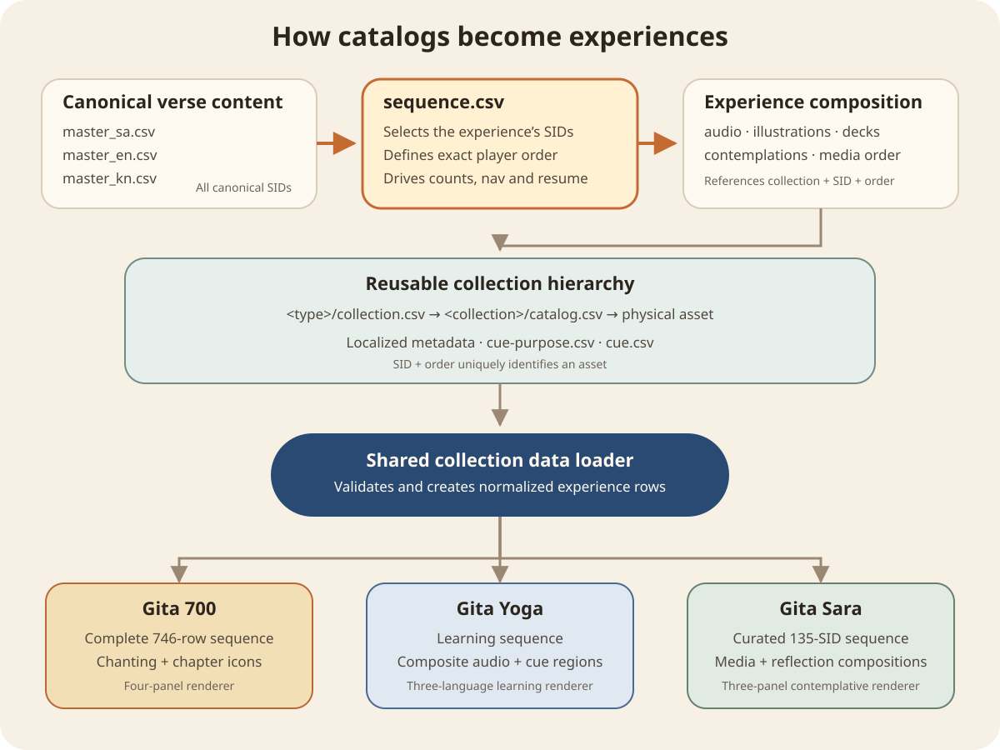

# How catalogs become experiences

**Status:** Current  
**Last updated:** 12 October 2026

Gitaverse separates canonical verse content, experience selection, reusable media, and rendering. The same verse and media collections can therefore serve different learning purposes without duplicating their source data.



## Shared hierarchy

```text
Canonical verse content
data/collections/verses/bhagavad-gita/
├── master_sa.csv
├── master_en.csv
└── master_kn.csv
              │ joined by SID
              ▼
Experience definition
data/collections/experiences/<experience>/
├── sequence.csv          ← selects SIDs and defines player order
├── audio.csv             ← associates audio collections
├── illustrations.csv     ← associates illustration collections
├── contemplations.csv    ← associates questions and reflections
├── decks.csv             ← associates Google decks
└── media.csv             ← orders different media types together
              │ collection + SID + asset order
              ▼
Reusable collection registry
data/collections/<type>/collection.csv
              │
              ▼
Individual reusable collection
data/collections/<type>/<collection>/
├── catalog.csv
├── localized metadata
├── cue-purpose.csv / cue.csv when applicable
└── physical assets
              │
              ▼
Collection data loader → normalized experience dataset → renderer
```

`SID` identifies a verse across canonical masters, experience files, catalogs, analytics, and resume state. `SID + order` identifies a particular reusable asset when one verse has multiple recordings, illustrations, questions, decks, or other media.

## The role of sequence.csv

`sequence.csv` is the authoritative selection and navigation list for an experience:

```text
position#cid#snum#sid
1#D#1#D.1
2#D#2#D.2
...
10#1#1#1.1
...
135#18#78#18.78
```

It determines:

- which canonical SIDs belong to the experience;
- the exact previous/next navigation order;
- current position and total count;
- whether a saved resume SID remains valid;
- the expected SID membership and relative order of sparse experience compositions.

It does not duplicate verse text. The loader uses each selected SID to retrieve Sanskrit, English, and Kannada content from the canonical masters, then joins the experience-specific media references.

## Gita 700

```text
Canonical Bhagavad Gita masters
              +
Complete sequence.csv: all 746 records in canonical order
              +
Swami Brahmananda chanting catalog
              +
Gita chapter-icon catalog
              ▼
Normalized Gita 700 dataset
              ▼
Four-panel renderer
Shloka · Transliteration · Meaning · Word-by-word meaning
```

Here `sequence.csv` represents the complete supported scripture journey. Audio and chapter icons are reusable collections; the Gita 700 compositions state which collection assets serve this experience.

## Gita Yoga

```text
Canonical Bhagavad Gita masters
              +
Complete learning sequence.csv
              +
Padma–Vijay learning-audio collection
├── catalog.csv
├── cue-purpose.csv
└── cue.csv
              ▼
Normalized Gita Yoga dataset
              ▼
Three-language learning renderer + selectable audio segments
```

The experience sequence controls verse navigation. Within the current verse, `cue.csv` locates learning segments in the composite recording and `cue-purpose.csv` supplies their localized purpose and description. Missing work-in-progress audio does not remove the verse from the sequence.

## Gita Sara

```text
Approximately 746 canonical records
              │
              │ sequence.csv selects and orders 135
              ▼
135 curated records
              +
audio.csv · illustrations.csv · contemplations.csv · decks.csv
              +
media.csv establishes cross-media order
              ▼
Normalized Gita Sara dataset
              ▼
Three-panel renderer
Shloka · Illustration/media · Reflection
```

Gita Sara demonstrates why selection is separate from canonical content. Its `sequence.csv` contains nine Dhyana records and 126 chosen Bhagavad Gita shlokas in the intended teaching order. Missing media never changes that order.

For SID `2.12`, the join is:

```text
sequence.csv
position → SID 2.12
              │
              ├── master_sa.csv → Sanskrit shloka
              ├── master_en.csv → English content
              ├── master_kn.csv → Kannada content
              ├── audio.csv → chanting collection and asset order
              ├── illustrations.csv → gita-sara-illustrations, order 1
              ├── illustration catalog → 2.12-1.webp
              ├── contemplations.csv → ordered reflection questions
              └── media.csv → presentation order across media types
```

If `2.12-1.webp` has not yet been generated or cannot be loaded, the player displays the shared default illustration. SID `2.12` retains its curated position and all other content remains available.

## Player boundary

The shared loader validates identities, orders, collection references, localized metadata, and safe media URLs. It produces a normalized row model so renderers do not parse catalogs or contain provider paths. Each renderer decides only how its normalized content is presented.
